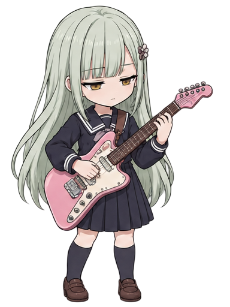

# 幕间 · 睦桌宠

一个住在 Windows 桌面上的非官方同人工具。单击和她互动，双击在若叶睦与 Mortis 之间切换。睦闲下来会抱起吉他，Mortis 喜欢歪着头从屏幕边缘偷看。右键点她，可以聊天、翻译或记事。

 

## 运行

把桌宠解压到一个可写的文件夹，双击 `Mutsumi.exe` 即可运行。桌宠使用 .NET Framework 4.8。Windows 11 和 Windows 10 1903 起的常见版本已预装 4.8 或 4.8.1。如果系统提示缺少组件，可以安装微软的 4.8 运行时。[微软运行时下载](https://dotnet.microsoft.com/zh-cn/download/dotnet-framework/net48)

动作和手势都可以离线使用。要聊天或记事，请先在本机登录可使用 GPT-6.2 Sol 的 Codex。桌宠会自动查找 Windows 版 Codex，也支持 `PATH` 中的 `codex.exe`。

## 和她互动

| 手势 | 左键 | 右键 |
| --- | --- | --- |
| 单击 | 随机互动、叫醒她，或让她从边缘出来 | 打开对话气泡 |
| 双击 | 切换若叶睦 / Mortis | 坐下睡觉 |
| 原地长按 | 收进系统托盘 | 保存并退出 |

按住左键拖动可以给她换个位置。拖到屏幕四边松手，她会顺势藏起来。藏在侧边时，睦会用一只手扒住边缘，Mortis 只探出歪着的脑袋。收进托盘后，单击托盘头像或再次运行程序就能叫她回来。

单击时，睦可能会递给你一片拨片，或分你一边耳机。Mortis 会鞠躬谢幕，也可能送你一枝玫瑰。待机时她们会眨眼、挠头，安静久了还会打盹。

## 对话与记事

右键打开「和若叶睦说话」或「和 Mortis 说话」。Enter 发送，Shift+Enter 换行，Esc 收起草稿。贴边时，气泡会在屏幕内侧展开。等回复时可以继续拖动或切换身份，换人后她也会接着上一轮聊。需要核实信息时可以联网搜索。

两个身份共用长期记忆。试试说「以后帮我记练琴，每次记曲目和时长」，过后直接告诉她「今天练了二十分钟《春日影》」。想回顾时问「这周一共练了多久」，想删掉时说「忘掉这个练琴本」。

每次对话会将本次消息、最近几轮问答和记事本目录发送给 Codex，需要查阅时再发送相关记录。最近的问答保存在内存里，退出即清空。对话使用本机 Codex 的临时会话。

## 本地数据

桌宠把设置和长期记忆保存在 `Mutsumi.exe` 旁边的 `data\` 文件夹中。

| 文件 | 用途 |
| --- | --- |
| `data\settings.xml` | 保存身份、位置和偏好。退出后可以编辑大小（`size`）、置顶（`pinned`）和自主互动（`autonomous`）。 |
| `data\memory.sqlite` | 保存长期记忆。要清空全部记忆，退出桌宠后删除此文件即可。 |

## 从源码编译

开发使用 **.NET 10 SDK** 编译同一个 `net48` 项目。安装 .NET 10 SDK（本项目使用 10.0.401，支持同一功能带的后续补丁）和 .NET Framework 4.8 开发人员工具包，然后在项目目录打开 PowerShell。[.NET 10 SDK](https://dotnet.microsoft.com/zh-cn/download/dotnet/10.0) · [.NET Framework 4.8 开发人员工具包](https://dotnet.microsoft.com/zh-cn/download/dotnet-framework/net48)

```powershell
dotnet build .\Mutsumi.Desktop.csproj -c Release -o dist
.\dist\Mutsumi.exe
```

## 角色与素材

本作是《BanG Dream! It's MyGO!!!!!》与《BanG Dream! Ave Mujica》的非官方同人桌宠。角色与原作相关权利归各自权利人所有。桌宠画稿使用 ImageGen 绘制，原画和动画图层位于 `Assets`。[若叶睦角色介绍](https://anime.bang-dream.com/mygo/character/mutsumi/) · [Mortis 角色介绍 CM](https://www.youtube.com/watch?v=N7hGFcHQd6U)

程序代码和构建工具采用 MIT 许可证。角色素材的权利归属与使用说明见同人作品声明。[MIT 许可证](LICENSE) · [BanG Dream! 同人作品声明](NOTICE.md)
